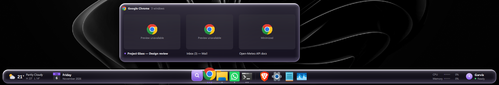
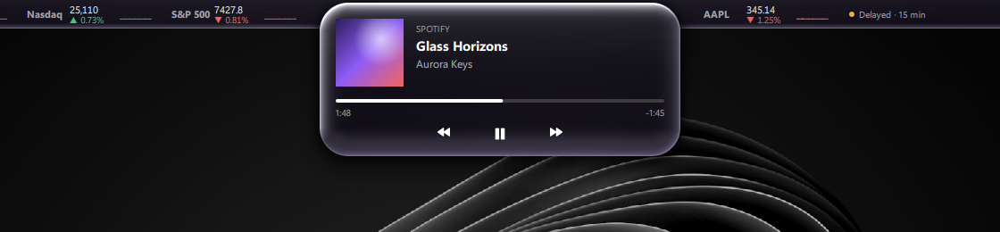
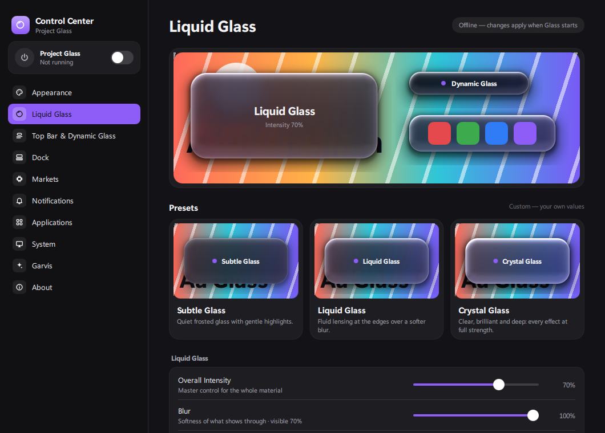

# Project Glass

An Apple-inspired desktop layer for Windows, built in Python and Qt Quick, with a UI Automation engine that lets an AI
assistant operate apps semantically instead of through screenshots.



<p>
  
  
</p>

*Off-screen renders of the real QML (`tools/preview/render.py`, `tools/preview/render_cc.py`) on a fixed 1920×1080
virtual display with demo data. Live window thumbnails can't appear in off-screen captures, so the preview shows its
fallback cards.*

## Why it exists

Windows' shell can't be restyled, and desktop automation for AI agents usually means screenshots, OCR and blind
clicks. Project Glass addresses both. It is a reversible shell that sits on top of Explorer (never replacing it), and
a separate engine that exposes windows and controls through Windows UI Automation over an authenticated local pipe.

Garvis is the author's private desktop AI assistant. Project Glass exposes its UI-automation tools to Garvis as
`glass_*` tools, with per-client scopes, a deny list, an audit log and an emergency stop.

## Features

- **Dynamic Glass top bar:** a pill that shows music, notifications, volume/power/network pulses and automation
  activity; market tickers either side; Wi-Fi, sound, battery and clock flyouts.
- **Dock:** a thin full-width bar with live DWM window previews, pinned/open/recent apps, widgets (weather, calendar,
  clock, system load), magnification that never shifts layout, and full keyboard navigation.
- **Liquid Glass material:** a custom GPU shader (refraction of the real wallpaper, dispersion, Fresnel, adaptive
  readability) with Subtle / Liquid / **Crystal** (default) presets and every parameter adjustable.
- **Control Center:** theme and accent, material, Dock, markets, notifications, startup, recovery and automation
  permissions.
- **Always reversible:** a master power switch, and a watchdog that owns a recovery hotkey, restores the taskbar if
  the shell crashes and stops restarting after repeated failures.
- **Automation engine:** list/inspect windows, find elements, invoke, enter text, window operations and change
  events, with no screenshot or OCR fallback. See [docs/PROTOCOL.md](docs/PROTOCOL.md).

## Tech stack

Python · PySide6 (Qt Quick/QML on Direct3D 11, custom GLSL shader compiled to `.qsb`) · Windows UI Automation via
`comtypes` · WinRT bindings (media, power, network, notifications) · named pipes with DPAPI-protected tokens ·
SQLite settings store · pytest + pytest-qt.

## Requirements

- Windows 10 2004+ or Windows 11
- Python 3.11+ (developed and tested on 3.14)
- No administrator rights. It runs with Smart App Control on: no unsigned native binaries are involved.

## Install and run

```bat
py -3 scripts\install.py            :: per-user install, no administrator rights
py -3 scripts\install.py --startup  :: also start Glass at sign-in
```

The installer creates `.venv` (reusing the system PySide6), installs `requirements.txt`, compiles the shader and adds
**Start › Project Glass** with *Project Glass*, *Glass Control Center* and *Restore Windows Desktop*.

Run it from the Start menu, or with `.venv\Scripts\pythonw.exe -m glass.shell`.
Uninstall with `py -3 scripts\install.py --uninstall` (your settings in `%LOCALAPPDATA%\ProjectGlass` are kept).

**Getting the normal desktop back:** press **Ctrl+Alt+Shift+R** at any time. It is handled by the watchdog, so it
works even if the shell hangs. **Ctrl+Alt+Shift+G** toggles Glass off and on. Everything else is in
[docs/USAGE.md](docs/USAGE.md).

## Run the tests

```bat
.venv\Scripts\python -m pip install -r requirements-dev.txt
set QT_QPA_PLATFORM=offscreen
.venv\Scripts\python -m pytest tests/core tests/shell tests/automation/test_units.py tests/automation/test_server.py -m "not slow" --ignore tests/shell/test_shell_process.py --ignore tests/shell/test_dock_qml.py
.venv\Scripts\python -m ruff check .
```

Result on 2026-11-07 (Windows 11, Python 3.14.5, PySide6 6.11.2): **305 passed, 2 deselected**. This is the
off-screen set that CI runs: no window appears and no input is sent.

The remaining suites start a real shell process, render the Dock QML in a subprocess, or drive off-screen test
windows through the live UI Automation engine; see [docs/TESTING.md](docs/TESTING.md).

## Project structure

```
glass/
  shell/          the shell process: Dynamic Glass, Dock, markets, local Shell API
  controlcenter/  the Control Center app
  automation/     UI Automation engine + authenticated pipe server for Garvis
  core/           settings, theme, material, IPC, security, markets, weather (mostly pure, unit-tested)
  recovery/       watchdog and taskbar restore
  win/            Win32/WinRT integrations: AppBars, DWM thumbnails, windows, media, audio, notifications
  ui/             QML (top bar, flyouts, Dock, Control Center) and the Liquid Glass shader
scripts/          per-user installer, optional package-identity script
tools/            off-screen preview renderers, perf soak, test target windows
docs/             architecture, protocol, material, testing, limitations, usage
```

## Known limitations

- **Market data uses Yahoo Finance's unofficial chart endpoint.** It is undocumented, has no published terms for
  apps, can change without notice, and quotes may be delayed; every ticker shows a freshness label (Live, Delayed,
  Closed or Not updated since).
- Floating panels (player, flyouts, previews) refract the wallpaper layer, not the window beneath them.
- DWM window thumbnails are drawn above Glass's content, so they can't have rounded corners; minimised windows show
  a fallback card.
- Mirroring other apps' Windows notifications requires package identity (`scripts/install-identity.ps1`), which is
  untested.
- Pointer feel, live DWM thumbnails and on-screen frame pacing have not been verified by automated tests; those tests
  never put windows on the desktop or inject input.

Full list: [docs/LIMITATIONS.md](docs/LIMITATIONS.md).

## Documents

- [docs/USAGE.md](docs/USAGE.md): power switch, recovery, top bar, Dock, Control Center, Garvis tools.
- [docs/ARCHITECTURE.md](docs/ARCHITECTURE.md): processes, data, IPC, security.
- [docs/PROTOCOL.md](docs/PROTOCOL.md): the computer-control protocol.
- [docs/LIQUID_GLASS.md](docs/LIQUID_GLASS.md): the material, refraction and performance measurements.
- [docs/NOTIFICATIONS.md](docs/NOTIFICATIONS.md): mirroring Windows notifications (package identity).
- [docs/TESTING.md](docs/TESTING.md): test suites and results.
- [docs/LIMITATIONS.md](docs/LIMITATIONS.md): what is and isn't done.

## License

MIT. See [LICENSE](LICENSE).
